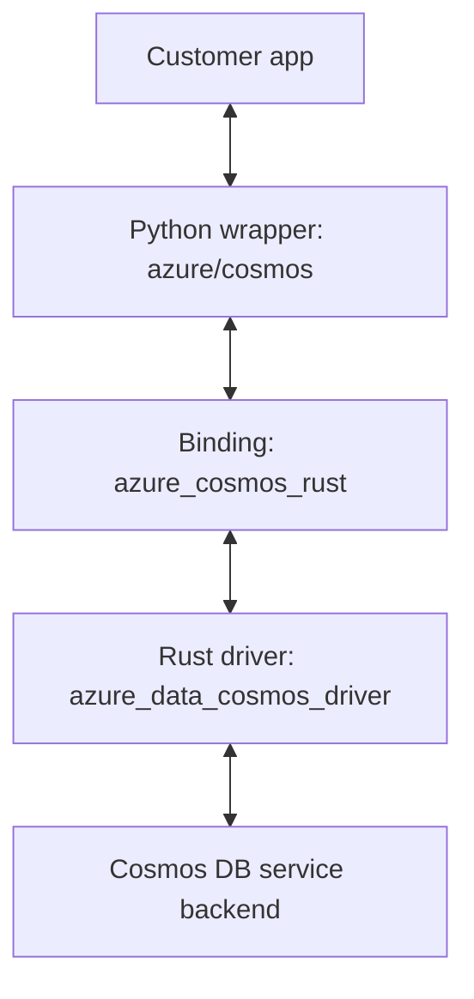

# Rust migration: architecture and source review guide

For reviewers familiar with the Cosmos Python SDK, this guide maps the Python
wrapper and binding folders in `sdk\cosmos\azure-cosmos`: what to review, what
remains, and what is temporary legacy support.

Samples, workloads, profiling tools, and the test-folder inventory are outside
this architecture walkthrough.

## 1. Responsibility boundaries



| Layer | Responsibility |
|---|---|
| **Python wrapper** | Public APIs, validation, operation/page orchestration, hooks, telemetry, and adapters that call the binding |
| **Binding** | Translate Python inputs into driver operations; manage runtimes and driver handles; return Python-compatible results and errors |
| **Rust driver** | Separately owned dependency providing service requests, signing, routing, retries, metadata/session state, and query execution |

The binding and Rust driver are compiled into `azure.cosmos._rust`;
`_rust.pyi` declares the Python-callable boundary.
They are not separate service processes.


## 2. Python wrapper folders

Paths in this section are relative to `azure\cosmos`.

### `_backend`

**New internal package for the Rust integration.** Contains the Python adapters,
binding contracts, configuration, and credential handling.

| Contents | Reviewer guidance |
|---|---|
| Adapters and conversion: `binding_adapter.py`, `_binding_adapter_shared.py`, `_binding_conversions.py` | **Review focus:** binding calls, driver-handle ownership, deadlines, and result/error conversion |
| Contracts and settings: `contracts.py`, `_immutable.py`, `cosmos_backend.py`, `operations.py`, `errors.py`, and configuration/setting modules | **Review focus:** binding inputs, request ownership, and error behavior. **Temporary—planned removal:** legacy-routing branches, not the active interfaces |
| Credentials: `credentials.py`, `_async_credential_bridge.py` | **Review focus:** credential ownership and callbacks to the customer's async event loop |
| `factory.py`, `constants.py` | **Review focus:** Rust-adapter construction and required constants. **Temporary—planned removal:** Rust/legacy selection through `_backend` and `COSMOS_BACKEND`, including the legacy default |
| `capabilities.py` | **Review focus:** argument validation and default preparation. **Temporary—planned removal:** legacy fallback decisions |
| `legacy.py`, `_fallback_metrics.py` | **Skip for this review. Temporary—planned removal.** Legacy execution and fallback accounting retained for parity checks and unfinished migration paths; removed before the Rust-only release |

Skipping temporary legacy files here does not exempt changes that affect
parity-test validity or alter the active Rust path from review.

### `_change_feed`

**Existing package with migration changes.** Contains the legacy Python
change-feed fetchers, iteration, continuation state, and feed-range representations.

| Contents | Reviewer guidance |
|---|---|
| `change_feed_fetcher.py`, `change_feed_iterable.py`, and their `aio\` counterparts | **Skip for this architecture review. Temporary—planned removal.** Legacy change-feed execution retained for parity checks |
| `change_feed_state.py`, `change_feed_start_from.py`, `change_feed_utils.py`, `composite_continuation_token.py`, `feed_range_composite_continuation_token.py` | **Temporary—planned removal.** Legacy state, input handling, and continuation support; remove with their remaining callers and imports |
| `feed_range_internal.py` | **Review focus:** shared range representation, not change-feed execution. `FeedRangeInternalEpk` is still used to format Rust feed-range results and normalize ranges for session-token handling. Preserve or relocate that functionality before removing this file |

For the Rust change-feed implementation, review the classes and functions in
`_helpers\_change_feed.py`
(synchronous paging and shared configuration/state) and
`aio\_helpers\_change_feed.py`
(asynchronous paging), followed by the binding's
`wire\item_feed.rs`.
These two Python files execute Rust change-feed operations through the binding.
They temporarily retain a separate legacy path for parity checks; only that
path uses the old fetchers in `_change_feed\`.

### Other folders and root-level files

| Folder or module family | Contents and responsibility | Review priority |
|---|---|---|
| `__init__.py`, `cosmos_client.py`, `database.py`, `container.py` | Public exports, client construction, database/container proxies, API validation, and delegation to operation helpers | **Active.** Start here for signatures and public behavior |
| `aio\` | Async public clients/proxies, adapter, and operation coordinators. Shared request builders and contracts come from the synchronous package | **Active and mixed.** Compare behavior with sync; do not assume every async file is new |
| `_helpers\` | Request preparation, item/database/container operations, throughput coordination, feed ranges, paging, response parsing, and shared client state | **Active and mixed.** Most operation behavior is here; legacy helper files and branches are called out below |
| `aio\_helpers\` | Awaiting execution, async page iteration, cancellation, and async orchestration over shared preparation rules | **Active and mixed.** Review cleanup and deadlines as well as returned values |
| `aio\_backend\` | Async execution interface, adapter, factory, and retained legacy adapter | **Active and mixed.** Shared contracts/settings remain in `_backend\` |
| `runtime.py`, `_runtime_constants.py` | Public `CosmosRuntime` and connection-pool configuration/validation | **Active.** Separate runtime-wide networking settings from client and operation settings |
| `_telemetry.py`, `_diagnostic_logging.py`, `diagnostics.py` | Public-operation tracing, binding-attempt contributions, diagnostic logging, and diagnostics-facing utilities | **Active.** Review context isolation and failure reporting |
| `_operation_deadline.py` | Shared deadline calculations and async waiting, plus retained legacy deadline adapters | **Active and mixed.** A timeout budget must not restart between internal steps |
| `_cosmos_responses.py`, `exceptions.py`, `errors.py`, `offer.py`, `documents.py`, `partition_key.py` | Customer-visible results, errors, settings/model types, throughput properties, and partition-key values | **Shared/public.** Old filenames are not evidence these contracts can be removed |
| `_query_advisor\` | Parsing and formatting query-advice results, including use by the Rust item-query helper | **Active.** Not the legacy query executor |
| `_inference_client.py`, `_inference_service.py`, `_inference_auth_policy.py`, and async counterparts | Client-owned, lazily initialized access to the separate inference service | **Active.** Keep separate from retirement of the Cosmos Python request pipeline |
| `_routing\`, including `aio\` | Legacy partition-map providers plus shared range representations | **Mixed.** For example, `routing_range.Range` is imported by Rust query/feed-range helpers |
| `_execution_context\`, including `aio\` | Legacy Python query dispatch, document producers, and result aggregation | **Legacy execution machinery.** Review migration boundaries first; see the retirement conditions below |
| `_cosmos_client_connection.py`, `aio\_cosmos_client_connection_async.py` | Retained connection objects, shared headers/settings, and legacy request methods | **Mixed and scheduled for retirement.** Do not skip the entire files |
| Other root-level utilities and policy modules | Shared encoding/configuration helpers alongside legacy HTTP, retry, session, and endpoint machinery | **Classify by caller.** The detailed distinction is in section 6 |

### What to look for inside `_helpers`

| Files | Work to review |
|---|---|
| `_item_context.py` | `ItemClientContext` retains the adapter, defaults, response state, and telemetry registrations shared by proxies. It owns no service transport or metadata cache |
| `_item_operations.py`, `_item_arguments.py`, `_item_prep.py`, `_document.py`, `_request_item.py` | Single-item argument normalization, body encoding, conditional settings, request construction, and result handling |
| `_database_operations.py`, `_container_operations.py`, `_request_database.py`, `_request_container.py` | Resource CRUD and get-or-create orchestration; distinguish multiple intended driver calls from a fallback |
| `_batch_operations.py` | Transactional-batch validation and request/result handling |
| `_database_throughput.py`, `_container_throughput.py`, `_throughput_*`, `_request_throughput.py` | Metadata/offer lookup, throughput parsing, and composed read/replace behavior |
| `_list_databases.py`, `_list_containers.py`, `_metadata_feed.py` | Database/container list and query configuration, page state, continuation, deadlines, and hooks |
| `_query_items.py`, `_read_all_items.py`, `_change_feed.py` | Item-query, read-all, and change-feed pagers using retained binding feed cursors |
| `_read_items.py`, `_feed_range_operations.py` | Read-many validation/result ordering and feed-range preparation. Read-many execution also uses the mixed root-level read-items helpers |
| `_request_settings.py`, `_partition_key.py`, `_paths.py`, `_pk_extract.py`, `_resource_validation.py`, `_wire_encoding.py` | Shared normalization and validation. These helpers are not a second driver implementation |
| `_response_parse.py`, `_exceptions.py`, `_page_response_hook.py` | Result/error interpretation and callback behavior after execution |
| `_legacy_item_operations.py`, `_legacy_partition_key.py` | Retained legacy-specific preparation/execution helpers, not the preferred Rust operation path |

## 3. Binding crate map

Paths in this section are relative to `azure_cosmos_rust\src`.

| Folder or module | Responsibility | Review focus |
|---|---|---|
| `lib.rs` | Registers `azure.cosmos._rust` exports and classes | Export names and agreement with `_rust.pyi` |
| `ffi\` | Python-callable item, database, container, query, offer, and feed-range entry points | Operation-name/protocol validation, typed extraction, and sync/async contracts |
| `wire\` | Constructs driver inputs, runs operations, and converts responses | This is binding implementation, not a Python HTTP transport |
| `wire\request.rs`, `wire\settings.rs`, `wire\partition_key_input.rs` | Extracts prepared requests and applies typed settings/headers | Missing versus explicit values, supported options, and validation before service work |
| `wire\items.rs`, `databases.rs`, `containers.rs`, `offers.rs`, `batch.rs`, `container_metadata.rs`, `feed_range.rs`, `query.rs` | Operation-family translation and execution | Correct driver operation, address/partition scope, metadata dependencies, and composed steps |
| `wire\item_feed.rs` | `_ItemFeedCursor` and the retained driver operation plan for item feeds | Per-iterator ownership, continuation, cancellation, and preventing concurrent cursor misuse |
| `wire\driver_runner.rs`, `wire\deadline.rs`, `wire\lifecycle.rs` | Shared Rust execution, timeout, and cancellation mechanics | GIL boundaries, awaited cleanup, and what cancellation does not guarantee |
| `wire\response.rs`, `wire\errors.rs`, `wire\diagnostics.rs` | Converts driver response bodies/headers/errors and collects diagnostic contributions | Preserve body shapes and error causes; do not invent headers or retry totals unavailable from the driver |
| `runtime.rs` | Acquires/releases `CosmosDriver` objects and exposes opaque `_DriverHandle` objects | Driver identity includes account, credential, settings, and runtime; handles retain the exact driver independently of cache eviction |
| `driver_runtime.rs` | Explicit `CosmosDriverRuntime` instances and the default singleton | Shared resources, initialization failures, and independent runtime identities |
| `credential.rs` | Adapts Python credentials to the driver's credential interface | Token refresh, callback lifetime, and interaction with Python credential bridges |
| `feed_range_subset.rs` | Local feed-range subset comparison using driver representations | Do not describe a local comparison as a service request |

Not every binding export lives under `ffi\`: batch execution and retained
cursor operations are registered from `wire\`. Follow `lib.rs` rather than
assuming a directory-wide naming rule. Rust code guarded by `#[cfg(test)]`
is outside this source-review map's scope.

Do not conflate these objects when reviewing sharing or close behavior:

| Object | Meaning |
|---|---|
| `CosmosRuntime` | Public Python owner/reference for an explicit or shared driver runtime |
| `CosmosDriverRuntime` | Driver-owned runtime resources and client factories, including connection-pool configuration |
| `CosmosDriver` | Account/configuration-specific driver state retained by `_DriverHandle` |
| `RuntimeContext` / Tokio runtime | Binding access to the shared executor that runs Rust futures; not the driver's resource runtime |

## 4. Follow an operation, not every file

### One order read

Alpha Bank reads an order from `sales.orders`. For this walkthrough, the
client is already on the Rust path:

```python
orders = client.get_database_client("sales").get_container_client("orders")
order = orders.read_item(item="order-42", partition_key="customer-17")
```

1. `container.py` selects the item helper from the proxy's shared context and applies public-call behavior.
2. `_helpers\_item_operations.py` validates and prepares the read using `_request_item.py`. This is not a legacy HTTP request.
3. `BindingAdapter` acquires or reuses the driver handle, converts the request, and calls the binding with the remaining deadline.
4. `ffi\items.rs` validates and extracts the prepared input; `wire\items.rs` translates it into driver work.
5. The Rust driver performs the operation against the service backend. Required metadata resolution belongs to this Rust path, not a replay through the legacy connection.
6. `wire\response.rs` returns the binding result. Python conversion and response parsing produce the customer result or exception and publish the appropriate headers.

The async path uses `aio\_container.py`,
`aio\_helpers\_item_operations.py`,
and `AsyncBindingAdapter`.
Shared preparation is reused; awaiting and cancellation still need separate review.

### Paging has two different shapes

| API family | Python state | Binding/driver work |
|---|---|---|
| Database/container listing and queries | `_metadata_feed.py` owns one pager's continuation, failure state, and callbacks | The matching database/container binding operation fetches a page. Do not assume an item-feed cursor is involved |
| Item queries, read-all, and change feed | Separate query/read-all/change-feed configuration and page state | `wire\item_feed.rs` retains a driver plan in `_ItemFeedCursor`; a resumable token is a separate value, not the cursor itself |

`query_databases(None)` selects the database-listing binding operation;
SQL selects the database-query operation. Both retain the query API's
Python contract. Query projections must not be forced into resource dictionaries.

### Cross-cutting review invariants

- Input preparation, acquisition, metadata work, and internal retries must share the applicable deadline. A public page's budget must not restart at every empty service page.
- A failure in execution, parsing, or a customer callback must not replay an operation through legacy Python. Temporary pre-execution selection is a separate mechanism.
- Prepared inputs and each pager's state must not be changed by later caller mutations or another pager.
- Callback signatures and timing are API-specific; do not impose one universal response-hook shape.
- A client-wide last-response-header view is not per-operation storage under concurrency.
- Close or cancellation must preserve ownership and error causes. They do not prove rollback of service work already sent.

## 5. Build, packaging, and supporting folders

Paths below are relative to the package root unless stated otherwise.

| Location | What it contains | Reviewer treatment |
|---|---|---|
| `pyproject.toml`, `Cargo.toml`, `Cargo.lock`, `rust-toolchain.toml`, `azure_cosmos_rust\Cargo.toml` | Python build configuration, Rust workspace/dependencies, compiler selection, and binding features | **Active.** Read with the build guide; compilation and package installation are different contracts |
| `azure_cosmos_package_builder.py`, `azure_cosmos_build_metadata.py` | Build-backend integration, QueryPlanInterop staging, and version-metadata checks | **Active build code**, not customer request execution |
| `azure_cosmos_rust\build.rs`, `azure_cosmos_rust\query_plan_binary.rs` | Build-time commit labels and staged native-library architecture checks | **Active build code.** Architecture checks alone do not prove successful dynamic loading |
| `setup.py`, `MANIFEST.in`, `sdk_packaging.toml`, `api.metadata.yml`, `api.md` | Packaging/tooling integration and declared API metadata | Review consistency with the new build and public surface; do not discard solely because a file predates Maturin |
| `scripts\` | Toolchain/feed setup and repository validation entry points | Supporting tooling, not a production SDK request path |
| `scripts\v5\` | Migration/profiling/audit tooling | Review when changing the migration process, not as the primary service implementation |
| `samples\` | Customer-facing usage examples | Check against retained signatures and behavior, not as another implementation |
| `doc\`, `docs\` | Documentation sources and design/operational guides | This guide maps current Rust integration. `docs\core\PYTHON_ARCHITECTURE.md` explains the older Python request machinery, not the target Rust call graph |
| `..\ci.yml`, `..\templates\` under `sdk\cosmos` | SDK CI orchestration | Review build/release wiring separately from operation logic |
| `_rust.pyd`/`_rust.so`, native `.libs` assets, `target\`, `dist\`, environments and caches | Built/staged/local artifacts | Inspect their source and packaging rules; they are not extra handwritten SDK packages |

The Rust driver is a dependency outside this Python package. The current
workspace points at the neighboring `azure-sdk-for-rust` checkout for local
development. Review that dependency choice in `Cargo.toml` for release
portability; do not treat driver-source changes as part of this package's
binding implementation.

## 6. Legacy code: planned removal, not blanket exclusion

**Start with the active Rust path.** Legacy-only execution machinery can be
reviewed separately for retirement. However, a changed legacy branch, shared
utility, or migration selector is not safe to ignore just because its eventual
destination is deletion.

| Legacy area | Why it remains | Planned removal boundary |
|---|---|---|
| `_backend\legacy.py`, `aio\_backend\legacy.py`, `_helpers\_legacy_item_operations.py`, async legacy item helper | Explicit legacy execution during migration | Retire after no retained caller selects these implementations; keep the corresponding Rust operation helpers |
| `_backend`/`COSMOS_BACKEND` selection, legacy default, and legacy fallback branches/metrics in backend infrastructure | Temporary comparison and incomplete-migration support | Remove before the Rust-only release. Preserve active validation, request contracts, adapters, and error behavior in these same modules |
| `_cosmos_client_connection.py` and `aio\_cosmos_client_connection_async.py` | Public objects and some coordinators still retain settings, header state, query-mode information, or lifecycle access through them | Move remaining responsibilities to explicit context/helpers before removing the objects. Public clients/proxies remain |
| `_execution_context\`, `_query_iterable.py`, `aio\_query_iterable_async.py` | Legacy Python query dispatch, producers, aggregation, and paging | Retire legacy execution once no operation or shared helper depends on it; keep the new helper pagers and binding cursor implementation |
| Legacy request/retry/endpoint/session families, such as `_synchronized_request.py`, `aio\_asynchronous_request.py`, `_retry_utility*`, `_location_cache.py`, `_global_endpoint_manager*`, and `_session.py` | Python HTTP execution and its retry/routing/session machinery | Retire the legacy execution paths after dependency cleanup; extract any surviving public/shared pieces rather than deleting whole file families blindly |
| Legacy providers/fetchers inside `_routing\` and `_change_feed\` | Older routing and change-feed execution, with shared range/state dependencies still present | Remove obsolete implementations, not whole directories containing representations still consumed by active helpers |

### Files that still deserve full attention

- **`_backend\` is not a legacy folder.** `BindingAdapter`, contracts, credentials, and settings are central to the Rust design. `capabilities.py` also contains active argument validation.
- **The connection objects are mixed-use.** Rust clients defer the legacy pipeline/account setup until a retained legacy request needs it; retaining a Python connection object is not evidence every operation uses Python HTTP.
- **`_routing\routing_range.py` is shared.** Rust item-query and feed-range preparation import its `Range` representation.
- **`_read_items_helper.py` and its async counterpart are mixed.** They coordinate current read-many behavior as well as retained legacy paths.
- **`_base.py`, `_utils.py`, `_client_lifecycle.py`, and `_operation_deadline.py` are shared.** For example, active throughput handling imports `_base._deserialize_throughput`; client-construction unwind and deadline helpers remain necessary.
- **Public exports and inference settings survive a transport rewrite.** `ConnectionRetryPolicy` is still exported from `_retry_utility.py`; inference configuration also uses Python HTTP-policy settings. Changing those requires a compatibility decision or extraction, not incidental deletion.
- **`_query_advisor\` remains used by Rust query results.** It formats advice; it does not execute the old query pipeline.

The distinction to use in review is **active responsibility versus obsolete
implementation**, not new filename versus old filename. Keep release-blocking
cleanup visible, but spend the first review pass on the Python wrapper,
binding contracts, Rust operation construction, ownership, and packaging.
