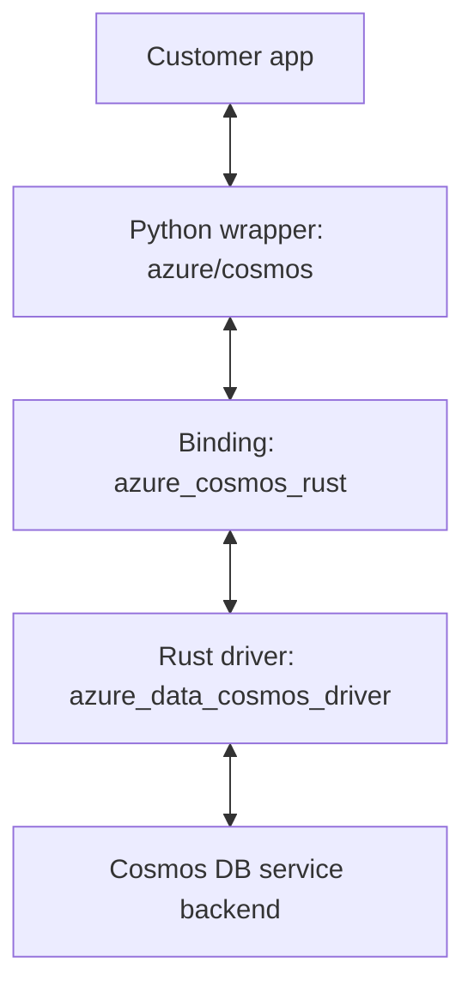

# Rust migration: architecture and source review guide

For reviewers familiar with the Cosmos Python SDK, this guide maps the Python
wrapper and binding folders in `sdk\cosmos\azure-cosmos`: what to review, what
remains, and what is temporary legacy support.

Samples, workloads, profiling tools, and the test-folder inventory are outside
this architecture walkthrough.

## 1. Responsibility boundaries



| Layer | Responsibility |
|---|---|
| **Python wrapper** | Public APIs, validation, operation/page orchestration, hooks, telemetry, and adapters that call the binding |
| **Binding** | Translate Python inputs into driver operations; manage runtimes and driver handles; return Python-compatible results and errors |
| **Rust driver** | Separately owned dependency providing service requests, signing, routing, retries, metadata/session state, and query execution |

The binding and Rust driver are compiled into `azure.cosmos._rust`;
`_rust.pyi` declares the Python-callable boundary.
They are not separate service processes.


## 2. Python wrapper folders

Paths in this section are relative to `azure\cosmos`.

### `_backend`

**New internal package for the Rust integration.** Contains the Python adapters,
binding contracts, configuration, and credential handling.

| Contents | Reviewer guidance |
|---|---|
| Adapters and conversion: `binding_adapter.py`, `_binding_adapter_shared.py`, `_binding_conversions.py` | **Review focus:** binding calls, driver-handle ownership, deadlines, and result/error conversion |
| Contracts and settings: `contracts.py`, `_immutable.py`, `cosmos_backend.py`, `operations.py`, `errors.py`, and configuration/setting modules | **Review focus:** binding inputs, request ownership, and error behavior. **Temporary—planned removal:** legacy-routing branches, not the active interfaces |
| Credentials: `credentials.py`, `_async_credential_bridge.py` | **Review focus:** credential ownership and callbacks to the customer's async event loop |
| `factory.py`, `constants.py` | **Review focus:** Rust-adapter construction and required constants. **Temporary—planned removal:** Rust/legacy selection through `_backend` and `COSMOS_BACKEND`, including the legacy default |
| `capabilities.py` | **Review focus:** registered operation support and early rejection of unsupported Rust requests. No operation permits legacy fallback |
| `legacy.py` | **Temporary—planned removal.** Explicit legacy execution remains for migration comparisons. Verify no-fallback behavior with legacy-call spies |


### `_change_feed`

**Existing package with migration changes.** Contains the legacy Python
change-feed fetchers, iteration, continuation state, and feed-range representations.

| Contents | Reviewer guidance |
|---|---|
| `change_feed_fetcher.py`, `change_feed_iterable.py`, and their `aio\` counterparts | **Skip for this architecture review. Temporary—planned removal.** Legacy change-feed execution retained for parity checks |
| `change_feed_state.py`, `change_feed_start_from.py`, `change_feed_utils.py`, `composite_continuation_token.py`, `feed_range_composite_continuation_token.py` | **Temporary—planned removal.** Legacy state, input handling, and continuation support; remove with their remaining callers and imports |
| `feed_range_internal.py` | **Review focus:** shared range representation, not change-feed execution. `FeedRangeInternalEpk` is still used to format Rust feed-range results and normalize ranges for session-token handling. Preserve or relocate that functionality before removing this file |

For the Rust change-feed implementation, review the classes and functions in
`_helpers\_change_feed.py`
(synchronous paging and shared configuration/state) and
`aio\_helpers\_change_feed.py`
(asynchronous paging), followed by the binding's
`wire\item_feed.rs`.
These two Python files execute Rust change-feed operations through the binding.
They temporarily retain a separate legacy path for parity checks; only that
path uses the old fetchers in `_change_feed\`.

### `_execution_context`

**Existing package with migration changes.** Contains the legacy Python query
executor, including its `aio\` implementation.

| Contents | Reviewer guidance |
|---|---|
| `execution_dispatcher.py`, `base_execution_context.py`, `document_producer.py`, and their `aio\` counterparts | **Skip for this architecture review. Temporary—planned removal.** Legacy query dispatch, page fetching, and buffering |
| `multi_execution_aggregator.py`, `non_streaming_order_by_aggregator.py`, `hybrid_search_aggregator.py`, `endpoint_component.py`, and their `aio\` counterparts | **Skip for this architecture review. Temporary—planned removal.** Legacy result merging, ordering, limits, and hybrid-search coordination |
| `aggregators.py`, `query_execution_info.py`, `aio\_queue_async_helper.py` | **Skip for this architecture review. Temporary—planned removal.** Legacy aggregate calculations, query-plan interpretation, and async queues |

The Rust `query_items` path does not use this package to execute queries.

### `_helpers`

**New internal package for the Rust integration.** Checks customer arguments,
builds requests, calls Python adapters, and turns responses into customer
results. Sync and async calls share request-building and response-reading code.
Some files also contain temporary legacy code; review their active parts
rather than skipping the whole file.

| Contents | Reviewer guidance |
|---|---|
| `_client_context.py` | **Review focus:** check how one client shares its adapter, defaults, latest response headers, and telemetry handlers. Shared client data must not be mistaken for data belonging to one operation |
| `_item_arguments.py` | **Review focus:** check how public arguments are combined and how the already-selected Python adapter is retrieved. **Temporary—planned removal:** the legacy `build_*_request_options` functions, not the shared argument helpers |
| `_item_operations.py`, `_item_prep.py`, `_document.py`, `_request_item.py` | **Review focus:** check arguments, copies of caller data, request body bytes, timeout budgets, adapter calls, and results. A failed Rust operation must not be run again through legacy Python |
| `_database_operations.py`, `_container_operations.py`, `_request_database.py`, `_request_container.py` | **Review focus:** check request building, adapter calls, returned results, and create-if-not-exists behavior. **Temporary—planned removal:** calls to the legacy connection inside the operation helpers |
| `_batch_operations.py` | **Review focus:** check sync and async batch calls, copied inputs, requests, each operation's result, which operation is reported as failed, and response hooks |
| `_database_throughput.py`, `_container_throughput.py`, `_throughput_setup.py`, `_throughput_read.py`, `_throughput_replace.py`, `_request_throughput.py` | **Review focus:** check how sync and async calls find the resource's offer (its throughput settings record), read or replace it, and return the settings. **Temporary—planned removal:** legacy read/replace calls and legacy-only option builders |
| `_throughput_rust_routing.py` | **Review focus:** check prepared requests, validation, response conversion, and headers for each result. **Temporary—planned removal:** backend-selection guards, not the active request/response helpers |
| `_list_databases.py`, `_list_containers.py`, `_metadata_feed.py` | **Review focus:** check database/container lists and queries: how each iterator tracks where to continue, applies its timeout budget, and calls response hooks. **Temporary—planned removal:** legacy page-fetching code |
| `_feed_paging.py` | **Review focus:** check page requests and responses, separate progress for each iterator, when cursors are kept or released after completion or failure, combined response headers, and response hooks |
| `_query_items.py`, `_read_all_items.py` | **Review focus:** check how the cursor keeps progress between pages, when iteration stops, and whether the API allows resuming with a continuation token. **Temporary—planned removal:** `uses_rust()` and `reject_rust_continuation_token()` in `_query_items.py`, not its active query preparation and paging |
| `_change_feed.py` | **Review focus:** check feed settings, fetching changes, which iterator holds the cursor, and whether a saved continuation token matches the new request. **Temporary—planned removal:** legacy code for fetching changes and tracking progress |
| `_read_items.py`, `_read_many.py` | **Review focus:** check item IDs and partition keys, required container metadata, page fetching, and response headers. Keep returned items in the requested order, including repeated requested items |
| `_feed_range_operations.py` | **Review focus:** check sync and async calls that find feed ranges, convert partition keys to ranges, test whether one range is inside another, and keep each call's results separate. **Temporary—planned removal:** legacy execution code |
| `_request_settings.py`, `_partition_key.py`, `_paths.py`, `_pk_extract.py`, `_resource_validation.py`, `_wire_encoding.py` | **Review focus:** check options and headers, partition-key values passed to the binding, reading property paths, extracting keys from items, valid resource IDs, and request body bytes |
| `_response_parse.py`, `_exceptions.py` | **Review focus:** check how responses become customer results or exceptions, which headers are recorded, and when response hooks are called |
| `_legacy_item_operations.py`, `_legacy_partition_key.py`, `_page_response_hook.py` | **Skip for this architecture review. Temporary—planned removal.** Old Python item execution, partition-key HTTP headers, and keeping callback errors out of legacy retry handling |

### `_routing`

**Existing package with migration changes.** Contains the old Python
partition-map cache alongside range helpers still used by Rust-backed clients.

| Contents | Reviewer guidance |
|---|---|
| `routing_range.py` | **Review focus:** check `Range` comparisons, merging, dictionary conversion, and boundary changes that must preserve the covered values. Rust query/feed-range preparation and session-token handling still use `Range`. **Temporary—planned removal:** legacy cache records and routing wrappers such as `PKRange` and `PartitionKeyRangeWrapper`, not `Range` |
| `routing_map_provider.py`, `aio\routing_map_provider.py` | **Review focus:** check cache sharing by endpoint, count each client's release once, and remove shared state only after the last client releases its share. Sync and async providers have separate caches; these are Python routing caches, not the Rust driver cache. Rust-backed clients still create and close these providers. **Temporary—planned removal:** these legacy partition-map providers |
| `_routing_map_provider_common.py` | **Review focus:** `_resolve_endpoint()` supplies the key used to group clients into endpoint caches. It runs during provider construction for Rust-backed clients too. **Temporary—planned removal:** this legacy provider support, including map-refresh decisions and retries |
| `collection_routing_map.py` | **Skip for this architecture review. Temporary—planned removal.** Build and update old Python partition maps, look up ranges, and check for gaps or overlaps |
| `feed_range_continuation.py` | **Skip for this architecture review. Temporary—planned removal.** Track saved continuation tokens and page progress for legacy feed-range queries, including partition splits |

### `aio`

**Existing package with migration changes.** Its `_backend\` and `_helpers\`
subfolders are new. Contains the async public clients, binding adapter, and
operation helpers alongside retained legacy code.

| Contents | Reviewer guidance |
|---|---|
| `__init__.py` | **Review focus:** preserve the public async client, database, and container exports |
| `_cosmos_client.py` | **Review focus:** check client settings, shared client state, `async with` initialization, cleanup after startup failure, and repeated or cancelled close calls. **Temporary—planned removal:** legacy backend selection and legacy account/pipeline setup |
| `_database.py`<br>`_container.py` | **Review focus:** check public arguments, delegation to operation helpers, returned results, and response hooks. Batch, throughput, and feed-range calls also delegate async execution to shared helpers, not just request building. Distinguish awaited operations from methods that return an async iterator without fetching its first page. **Temporary—planned removal:** legacy selection and execution branches, not the public APIs |
| `_backend\binding_adapter.py` | **Review focus:** check binding calls for operations, metadata, and pages; conversion of results/errors; timeout budgets; driver-handle acquisition/release; and the event loop used for async credentials. Tracing and diagnostic data must stay with the correct operation or page. Cancelling one caller must not cancel shared acquisition or cleanup |
| `_backend\cosmos_backend.py` | **Review focus:** check agreement between the requested operation and prepared request, page validation before execution, iterator cleanup, and error handling. **Temporary—planned removal:** legacy-path selection. A failed Rust operation or response hook must not be repeated through legacy Python |
| `_backend\factory.py` | **Review focus:** check adapter construction and forwarded settings. Construction returns an adapter without acquiring a driver handle. **Temporary—planned removal:** Rust/legacy selection |
| `_helpers\_item_operations.py`<br>`_helpers\_database_operations.py`<br>`_helpers\_container_operations.py` | **Review focus:** check shared request preparation, awaited execution, timeout budgets, create-if-not-exists behavior, and matching headers/results for each response hook. Hooks are called, not awaited. **Temporary—planned removal:** legacy connection calls in the database/container helpers |
| `_helpers\_query_items.py`<br>`_helpers\_read_all_items.py` | **Review focus:** check each iterator's cursor and progress, rejection of overlapping fetches, empty-page fetches under one timeout budget, and cancellation/failure cleanup. A query token, when available, must describe the last delivered page, not a pending fetch. Read-all does not support saved tokens |
| `_helpers\_read_many.py` | **Review focus:** check metadata and page fetching under one timeout budget, cursor release on success or failure, and returned item order, including repeated requested items |
| `_helpers\_list_databases.py`<br>`_helpers\_list_containers.py`<br>`_helpers\_metadata_feed.py` | **Review focus:** check async database/container lists and queries, separate progress for each iterator, timeout budgets, headers, and response hooks. **Temporary—planned removal:** legacy page fetching in `_metadata_feed.py` |
| `_helpers\_change_feed.py` | **Review focus:** check that repeated fetches within one poll share a timeout budget, along with cursor ownership, delivered continuation tokens, and cleanup when a fetch fails or is cancelled. **Temporary—planned removal:** legacy fetcher creation and execution |
| `_backend\legacy.py`<br>`_helpers\_legacy_item_operations.py` | **Skip for this architecture review. Temporary—planned removal.** Await explicitly selected legacy operations; these are not retries for failed Rust operations |
| `_cosmos_client_connection_async.py` | **Review focus:** check retained headers/settings, adapter access, and cleanup. Rust-backed clients still construct this object; an unused Python HTTP pipeline must not be created just to close it. **Temporary—planned removal:** legacy request methods and the Python HTTP pipeline |
| `_global_endpoint_manager_async.py`<br>`_global_partition_endpoint_manager_circuit_breaker_async.py`<br>`_global_partition_endpoint_manager_per_partition_automatic_failover_async.py` | **Review focus:** check construction and cleanup of these objects, which Rust-backed clients still retain, including cleanup of any account-refresh task. **Temporary—planned removal:** Python region selection and failure tracking |
| `_retry_utility_async.py` | **Review focus:** check `_ConnectionRetryPolicy`, which also serves the separate inference service, including failures without Cosmos request/routing state. **Temporary—planned removal:** the legacy Cosmos retry loop, not the policy used by inference |
| `_inference_service_async.py`<br>`_inference_auth_policy_async.py` | **Review focus:** check inference requests, authentication, settings, and response/error handling. This is a separate service path, not temporary Cosmos request execution |
| `_asynchronous_request.py`<br>`_asynchronous_availability_strategy_handler.py`<br>`_auth_policy_async.py`<br>`_gone_retry_policy_async.py` | **Skip for this architecture review. Temporary—planned removal.** Legacy Cosmos HTTP calls, authentication, extra requests to other regions, and split-related retry policy |
| `_query_iterable_async.py` | **Skip for this architecture review. Temporary—planned removal.** Legacy Python query iteration; Rust item queries use the async query helper instead |

### Root-level files

These files sit directly under `azure\cosmos`. The groups below describe their
responsibilities, not proposed new folders. The list covers files added or
changed for this migration that still support active behavior. Unchanged
retained files and legacy-only removal inventories are omitted.

#### Public APIs and package contracts

| Contents | Reviewer guidance |
|---|---|
| `__init__.py` | **Review focus:** check new public exports and preserve existing customer imports |
| `cosmos_client.py` | **Review focus:** check public arguments, client settings, shared state, startup, and close. **Temporary—planned removal:** legacy backend selection and legacy account/pipeline setup, not the public client |
| `database.py`<br>`container.py` | **Review focus:** check public arguments, delegation to operation helpers, returned results and pagers, tracing, and response hooks. **Temporary—planned removal:** legacy selection and execution branches, not the public proxies |
| `runtime.py` | **Review focus:** check `CosmosRuntime` creation, sharing of the underlying driver runtime, and immutable `ConnectionPoolOptions`. Keep runtime-wide connection-pool settings separate from client and operation settings |
| `documents.py` | **Review focus:** check public models, enums, and connection/retry settings still read during Rust client construction. Retaining those settings does not mean Python retry policies execute Rust requests |

#### Internal support and retained connection objects

| Contents | Reviewer guidance |
|---|---|
| `_rust.pyi` | **Review focus:** check declared binding arguments, returned values, handles/cursors, and which calls return awaitable results. Some exports still use the general `Any` fallback; this file is not a complete checked list of binding exports |
| `_client_lifecycle.py` | **Review focus:** check cleanup after failed client construction. Release already-created resources without creating new ones for cleanup, and preserve the original error. **Temporary—planned removal:** legacy request-initialization decorators and cleanup of the retained legacy connection |
| `_connection_string.py` | **Review focus:** check connection-string parsing and errors for missing or invalid values before client construction proceeds |
| `_connection_policy.py`<br>`_availability_strategy_config.py` | **Review focus:** check copied caller settings, which setting wins when supplied in multiple places, and conversion to supported Rust options. Unsupported settings must be rejected rather than silently ignored |
| `_telemetry.py`<br>`_diagnostic_logging.py` | **Review focus:** check operation/page tracing, diagnostic data returned by the binding, logging controls, and failure reporting. Concurrent operations must not use each other's tracing or diagnostic state |
| `_operation_deadline.py` | **Review focus:** check that preparation, waiting, and execution share one deadline, and that async timeout/cancellation waits for task cleanup. A deadline cannot interrupt a synchronous response hook or undo service backend work. **Temporary—planned removal:** `legacy_deadline_options` and `legacy_deadline_kwargs`, not the shared deadline helpers |
| `_base.py` | **Review focus:** check active option handling, resource paths, batch formatting, and throughput conversion. **Temporary—planned removal:** helpers used only for legacy HTTP headers/authentication and Python query-result merging, not the whole file |
| `_constants.py`<br>`http_constants.py` | **Review focus:** check option names, headers, status codes, and resource/configuration constants used by active callers. HTTP-related names alone do not identify legacy-only code |
| `_query_rust_routing.py` | **Review focus:** check database/container page-request builders, argument validation, and shared page-response conversion. Despite its name, this file does not select service regions or partition replicas. **Temporary—planned removal:** legacy/internal item-query compatibility handling, not the active metadata-page builders |
| `_feed_ranges_rust_routing.py` | **Review focus:** check prepared requests, validation, response conversion, and headers for each result. **Temporary—planned removal:** backend-selection guards, not the active request/response helpers |
| `_session_token_helpers.py` | **Review focus:** check parsing and merging of supplied session-token observations for the public latest-token calculation. This is local work; it neither fetches current service state nor replaces Rust driver session tracking |
| `_inference_client.py`<br>`_inference_service.py` | **Review focus:** check client-owned settings, lazy service creation, inference requests, authentication setup, and response/error handling. This separate service path remains after legacy Cosmos HTTP execution is removed |
| `_retry_utility.py` | **Review focus:** check the publicly exported `ConnectionRetryPolicy`, its inference use, and helpers shared with the async policy. Check failures without Cosmos request/routing state. **Temporary—planned removal:** the legacy Cosmos `Execute` retry loop, not the entire module |
| `_cosmos_client_connection.py` | **Review focus:** check retained settings, headers, adapter access, and cleanup. Rust-backed clients still construct this object while deferring Python HTTP pipeline/account setup. **Temporary—planned removal:** the retained connection object and legacy request execution; preserve the active state and access that currently depend on it |

## 3. Binding crate map

Paths in this section are relative to `azure_cosmos_rust\src`.

### `ffi`

**New binding folder for the Rust integration.** Contains the Rust functions
called by the Python wrapper. They check prepared requests, extract Python
values into Rust types, and pass operation work to the binding's `wire\` helpers.
Most calls return a response tuple that the Python wrapper converts into a
customer result; container metadata has a separate input/result contract.

For each operation, check that sync and async entry points apply the same
input rules and forward the remaining timeout and supported diagnostic
options. Sync calls return a result; async calls return an awaitable, but
input validation can fail before that awaitable is returned.

| Contents | Reviewer guidance |
|---|---|
| `mod.rs` | **Review focus:** check the request protocol version and agreement between the requested operation and the called function. Check shared extraction of identifiers, partition keys, body bytes, and settings, including errors for missing or wrongly typed values. The exported functions must agree with the names registered for Python |
| `items.rs` | **Review focus:** check the selected item operation, partition-key requirements, and name-based versus `_self` targets. A replacement body's ID must not redirect the operation. Create/upsert may use the body ID only when `item_id` is `None` or empty. For PATCH, check that `If-Match` becomes a condition rather than a custom header, `If-None-Match` is rejected, and a filter condition forces service-side execution |
| `databases.rs` | **Review focus:** check create/read/delete inputs and account-scoped list/query requests, including query body bytes and page settings. Listing databases must not require a container or partition key. Create-if-not-exists decisions remain in the Python wrapper, not these individual binding calls |
| `containers.rs` | **Review focus:** check database/container identifiers, definition or query body bytes, and delegation of each operation to the matching execution helper. List/query calls return a page. `get_container_metadata` instead takes an explicit container link and returns metadata; do not treat it as another prepared-request operation |
| `offers.rs` | **Review focus:** check the offer query body and the offer resource ID used for replacement. Offers are account-level throughput records, not items in a partition. Preserve the difference between an offers-list response and the single updated offer returned by replacement |
| `feed_range.rs` | **Review focus:** check container links, typed partition keys, and the force-refresh flag passed to range lookup. Keep driver-backed lookup separate from `is_feed_range_subset`: the subset call reads two ranges from the body, ignores the driver handle, and performs a local comparison without contacting the service backend |
| `query.rs` | **Review focus:** check the query body, partition scope, settings, and timeout passed to the stateless query helper. Each call fetches one page without retaining a feed cursor. These compatibility entry points are not the public item-query path that keeps a cursor between pages |


### `wire`

**New binding folder for the Rust integration.** Builds Rust driver operations
from prepared inputs, runs them, and converts their results for Python.
It also owns the binding's retained feed cursors, timeout handling, and
diagnostic conversion. This is binding code, not the Rust driver's internal
implementation.

Review the sync and async paths together: they should preserve the same
operation behavior, even though waiting and cancellation work differently.
Metadata lookup, planning, and execution must share the supplied timeout
rather than each receiving a fresh budget.

| Contents | Reviewer guidance |
|---|---|
| `mod.rs` | **Review focus:** check module exports and `AbortOnDrop`, which requests cancellation when the Rust bridge future drops its guard. Requesting cancellation does not prove immediate cleanup or undo work already sent to the service backend |
| `request.rs` | **Review focus:** check resource-path parsing, required identifiers, copied body bytes, and driver options. Avoid parsing the body again just to recover an ID already supplied by create/upsert. For partition keys extracted from item bytes, preserve property-path rules, null versus missing values, and hierarchical keys. Keep the driver's timeout policy separate from the binding's remaining timeout |
| `settings.rs` | **Review focus:** check protocol versions, setting types, header names and values, and precedence when both typed settings and headers are supplied. Activity/session values and operation options must not remain conflicting custom headers. Preserve rejection of unsupported settings and trigger headers |
| `partition_key_input.rs` | **Review focus:** check conversion of typed Python partition keys into driver values. Preserve null, missing, boolean, string, and numeric components, and reject invalid types or non-finite numbers. Distinguish an explicit key, extraction from an item body, whole-container query scope, and empty-key forms; each operation accepts different forms |
| `driver_runner.rs` | **Review focus:** retain the exact driver owned by the supplied handle throughout the call. Sync waiting releases Python's global interpreter lock but still blocks the calling thread. Async work runs on the Rust executor and returns a Python awaitable. Check preparation errors, task failures, cancellation, and result conversion back under the Python lock |
| `deadline.rs` | **Review focus:** check positive finite timeouts and record the deadline before work is scheduled, so waiting consumes the budget. Expired work must not start. Local calculations need checks before and after execution; timeout handling cannot interrupt synchronous work or roll back service backend changes |
| `items.rs` | **Review focus:** check container resolution by name or resource ID, preservation of `_self` targets, partition-key extraction, and the final driver operation. Metadata lookup and item execution share one budget. Apply write-response settings only to the appropriate writes, and keep metadata failures separate from item responses |
| `databases.rs` | **Review focus:** check account-level create/read/delete operations and one-page database lists/queries, including request settings, query bodies, timeout handling, and selection of the matching response converter. These operations do not need container metadata or an item partition key |
| `containers.rs` | **Review focus:** check database/container targeting and one-page lists/queries. Replacement and deletion resolve metadata before executing; keep both steps within one timeout. Write conditions and customer headers belong to the final write, not its metadata lookup |
| `container_metadata.rs` | **Review focus:** check container lookup, timeout/cancellation handling, and the separate metadata tuple: resource ID, partition-key paths, kind, and system-key information. `None` for system-key information means unknown, not false. Preserve response details when metadata errors become Python exceptions |
| `batch.rs` | **Review focus:** check prepared input validation, an explicit partition key, and a complete hierarchical key. If a mismatch may come from a recreated container, refresh metadata and validate again before execution. Keep lookup and execution within one timeout, preserve the batch response body, and distinguish metadata failures from rejected or executed batches |
| `offers.rs` | **Review focus:** check account-level offer queries and replacement by offer resource ID. Offer reads collect every page under one timeout; a later failure must not return partial success. Preserve replacement response content, forwarded settings, and diagnostic contributions from all fetched pages. The returned headers belong to the final page, not totals for the whole query |
| `item_feed.rs` | **Review focus:** check retained driver-plan ownership for queries, read-all, read-many, and change feed. Reject overlapping fetches and changes to the cursor's client, container, request, or continuation. Do not reuse a plan that may have advanced during a failed or cancelled fetch. Check query scope/buffering limits, continuation support, complete keys for read-many, and rejection of multi-partition change-feed scopes before execution and after possible splits |
| `query.rs` | **Review focus:** check stateless query-page execution, partition scope, request settings, and one timeout covering metadata and execution. This compatibility path does not retain a plan between calls; do not confuse it with the retained paging in `item_feed.rs` |
| `feed_range.rs` | **Review focus:** check driver-backed range lookup, force refresh, and partition-key-to-range conversion, including empty-key forms and hierarchical prefixes. Keep local subset comparison separate from service work. The async local comparison still needs timeout and cancellation handling |
| `response.rs` | **Review focus:** check the five-field response tuple, body bytes, and the correct JSON wrapper for each feed. Avoid unnecessary body decoding or copying. Headers come from the driver's conversion, not the original HTTP header collection. Preserve status/substatus, operation-specific error mapping, and original authentication exceptions when available. Optional diagnostic conversion must not replace the operation result or error |
| `errors.rs` | **Review focus:** check the Python exception types for errors without a response, metadata response errors, and unsupported query plans. An error without an attached response does not prove that no service request occurred or that a retry is safe |
| `diagnostics.rs` | **Review focus:** check attempt data, timestamps, reported conversion failures, and separation of ordinary telemetry from opt-in fault evidence. Ordinary attempt telemetry exposes the endpoint host, not full URLs, keys, or bodies. Debug counters cover only their recording paths; they are not complete network-request or retry totals. Consider the cost of formatting diagnostics |
| `lifecycle.rs` | **Review focus:** check the optional, single-use async operation probe and publication of its final state after the observed future is dropped. It is compiled into the binding, not restricted to test builds. It observes that future's lifetime, not socket cleanup, detached driver tasks, or service rollback |


### Root-level binding files

**New source files for the Rust integration.** These files sit directly under
the binding's `src` folder. They register the Python extension, manage runtime
and driver ownership, adapt credentials, and support local range comparison.

| Contents | Reviewer guidance |
|---|---|
| `lib.rs` | **Review focus:** check registration of Python-callable functions, sync/async counterparts, handle and cursor classes, exception types, and build-version information. Exported names and signatures must match what the Python wrapper calls. Distinguish internal diagnostic exports from customer APIs |
| `runtime.rs` | **Review focus:** check driver acquisition, client-setting validation, and conversion to driver options. Use the same copied settings for driver identity and construction; sharing must distinguish account, credential, settings, and selected runtime. Matching acquisitions coordinate creation without holding the global cache lock or Python lock while waiting. Failed creation must leave no cached acquisition. Each handle releases its count once, while outstanding references keep its exact driver alive; an old release must not affect a replacement driver. Check opt-in fault-rule controls separately from normal operation settings |
| `driver_runtime.rs` | **Review focus:** check connection-pool settings, sync/async runtime creation, and retry after failed default initialization. Explicit driver runtimes have separate identities; the default is created once on demand and shared. Runtime handles and acquired drivers retain their own references. Creating another driver runtime must not create another binding executor |
| `credential.rs` | **Review focus:** check token and expiry validation, scope-specific caching, coordinated refresh, and the restricted fallback from an account scope to the global scope. Sync credential callbacks run on blocking workers; cancelling the wait cannot stop an already-running Python call. Async credentials use completion callbacks and cancellation requests through the supplied bridge. Preserve authentication errors, never log tokens, and do not close the customer app's credential |
| `feed_range_subset.rs` | **Review focus:** check the parent/child JSON fields, hexadecimal bounds, and inclusive/exclusive boundary conversion against the retained Python behavior, including carry and borrow at boundary values. The driver's subset comparison is local: this file neither acquires a driver handle nor contacts the service backend |


## 4. Follow an operation, not every file

### One order read

Alpha Bank reads an order from `sales.orders`. For this walkthrough, the
client is already on the Rust path:

```python
orders = client.get_database_client("sales").get_container_client("orders")
order = orders.read_item(item="order-42", partition_key="customer-17")
```

1. `container.py` selects the item helper from the proxy's shared context and applies public-call behavior.
2. `_helpers\_item_operations.py` validates and prepares the read using `_request_item.py`. This is not a legacy HTTP request.
3. `BindingAdapter` acquires or reuses the driver handle, converts the request, and calls the binding with the remaining deadline.
4. `ffi\items.rs` validates and extracts the prepared input; `wire\items.rs` translates it into driver work.
5. The Rust driver performs the operation against the service backend. Required metadata resolution belongs to this Rust path, not a replay through the legacy connection.
6. `wire\response.rs` returns the binding result. Python conversion and response parsing produce the customer result or exception and publish the appropriate headers.

The async path uses `aio\_container.py`,
`aio\_helpers\_item_operations.py`,
and `AsyncBindingAdapter`.
Shared preparation is reused; awaiting and cancellation still need separate review.

### Paging has two different shapes

| API family | Python state | Binding/driver work |
|---|---|---|
| Database/container listing and queries | `_metadata_feed.py` owns one pager's continuation, failure state, and callbacks | The matching database/container binding operation fetches a page. Do not assume an item-feed cursor is involved |
| Item queries, read-all, and change feed | Separate query/read-all/change-feed configuration and page state | `wire\item_feed.rs` retains a driver plan in `_ItemFeedCursor`; a resumable token is a separate value, not the cursor itself |

`query_databases(None)` selects the database-listing binding operation;
SQL selects the database-query operation. Both retain the query API's
Python contract. Query projections must not be forced into resource dictionaries.

### Cross-cutting review invariants

- Input preparation, acquisition, metadata work, and internal retries must share the applicable deadline. A public page's budget must not restart at every empty service page.
- A failure in execution, parsing, or a customer callback must not replay an operation through legacy Python. Temporary pre-execution selection is a separate mechanism.
- Prepared inputs and each pager's state must not be changed by later caller mutations or another pager.
- Callback signatures and timing are API-specific; do not impose one universal response-hook shape.
- A client-wide last-response-header view is not per-operation storage under concurrency.
- Close or cancellation must preserve ownership and error causes. They do not prove rollback of service work already sent.

## 5. Build and packaging

Paths below are relative to the package root unless stated otherwise.

| Contents | Reviewer guidance |
|---|---|
| `pyproject.toml` | **Review focus:** check build-backend selection, Python dependencies, extension import path, wheel targets, and package inclusion/exclusion rules. Building the extension is not proof that the resulting wheel installs and imports correctly |
| `Cargo.toml`, `Cargo.lock`, `azure_cosmos_rust\Cargo.toml` | **Review focus:** check the driver dependency source, resolved dependency versions, and binding features. Keep the native query-planning feature consistent with library packaging. The driver must stay pinned to a GitHub commit (or a published version), never a local path |
| `rust-toolchain.toml` | **Review focus:** check the selected Microsoft Rust toolchain and how build environments obtain it. Declaring a toolchain does not install it |
| `azure_cosmos_package_builder.py` | **Review focus:** check temporary QueryPlanInterop library staging, cleanup after failure, recovery from interrupted builds, and coordination between concurrent builds. Preserve unrelated files. Check that the completed platform wheel contains exactly one nonempty compiled extension; source archives and editable installs must not stage release libraries |
| `azure_cosmos_build_metadata.py`, `api.metadata.yml`, `CHANGELOG.md` | **Review focus:** check that version validation rejects disagreement between `_version.py`, `pyproject.toml`, API metadata, and the first release heading in the changelog. Validation must not require importing the SDK or loading its extension |
| `azure_cosmos_rust\build.rs`, `azure_cosmos_rust\query_plan_binary.rs` | **Review focus:** check supplied build-commit labels and target-architecture checks for configured native libraries. Commit labels do not verify source contents, and architecture checks do not prove that a library loads or works at runtime |
| `setup.py` | **Review focus:** preserve its metadata-only role and agreement with package metadata. Unsupported build/install commands must fail rather than produce a package without the Rust extension |
| `MANIFEST.in` | **Review focus:** check that it keeps only the `py.typed` line. Maturin does not read this file, and `setup.py` cannot build packages, so it does not control package contents. It stays because the repository's sdist check (`eng\tools\azure-sdk-tools\azpysdk\verify_sdist.py`) requires a `py.typed` line when the file exists. Package contents are set by `[tool.maturin]` `include`/`exclude` in `pyproject.toml` |
| `api.md` | **Review focus:** compare the recorded API surface with intended public API changes. This is an API record, not build implementation |
| `scripts\install-msrustup.sh`, `scripts\configure-cargo-feed.sh` | **Review focus:** check toolchain installation and Cargo feed configuration in the environments that call these scripts, including Linux wheel-build containers. Required setup failures must fail the build; credentials must come from the build environment |
| `..\ci.yml` | **Review focus:** check toolchain setup and build/release settings for the Cosmos package. Signing and source-publication flags are requests to shared pipeline templates, not proof that those templates enforce them |
